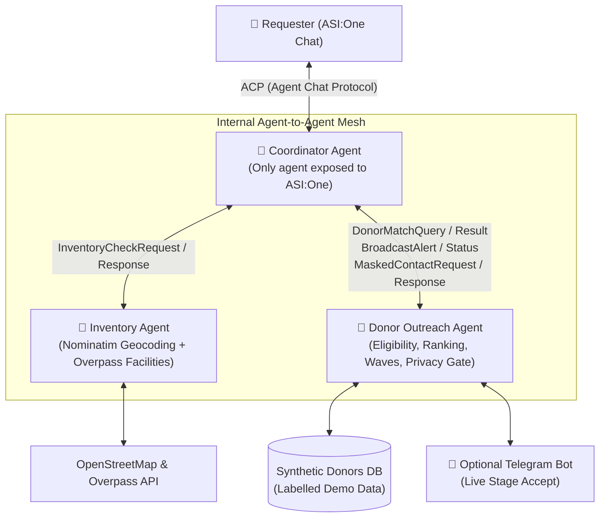

# 🩸 LifeLink: Emergency Blood Donor Agent

> **ASI:One Agent Challenge — "From Intent to Action"**  
> An autonomous multi-agent emergency response system built on Fetch.ai uAgents and the Agent Chat Protocol (ACP).

---

## 📌 Executive Summary

When a patient faces a medical emergency, families lose critical hours calling relatives, broadcasting frantically across WhatsApp groups, and calling hospitals one by one.

**LifeLink** solves this in seconds:
A user types a single sentence into **ASI:One**, such as:  
> *"Need 2 units of O+ at SMS Hospital, Jaipur, urgent"*

LifeLink autonomously:
1. **Parses & Validates Intent** (extracts blood type, units, hospital, and urgency in English or Hindi, asking at most one targeted clarifying question if incomplete).
2. **Queries Live Infrastructure** (geocodes coordinates via OpenStreetMap Nominatim and discovers nearby hospitals/blood banks with real-time demo stock).
3. **Applies Clinical Compatibility & NBTC Eligibility** (enforces red blood cell compatibility tables and National Blood Transfusion Council regulations in deterministic code—never LLM guesswork).
4. **Ranks Donors & Prepares Interactive Cards** (multi-factor ranking considering distance, reliability, availability, and verification tier; outputs rich ASI1 Carousel & Review Cards with full plain-text fallbacks).
5. **Orchestrates Wave Alerts & Privacy Gate** (dispatches wave notifications to nearest donors, handles live donor acceptance, and unlocks masked relay contact details only after acceptance).
6. **Delivers Final Confirmed Summary** (provides confirmed donor ETA, call bridge token, and backup blood banks within 2 minutes).

---

## 🏛️ Multi-Agent Architecture

LifeLink is powered by three specialized Fetch.ai uAgents communicating via typed `uagents.Model` protocols:



| Agent | Responsibility | Exposed to ASI:One? |
| :--- | :--- | :---: |
| **`coordinator`** | ACP handler, intent parsing, conversation state machine, card rendering with text fallbacks, orchestration. | **Yes** |
| **`inventory`** | Geocodes hospitals/cities, executes Overpass queries, looks up hospital stock levels, auto-expands radius if results are few. | **No** (Internal mesh) |
| **`donor_outreach`** | Enforces NBTC clinical intervals (90d male / 120d female), runs multi-factor ranking, dispatches alert waves with daily caps, manages privacy gate. | **No** (Internal mesh) |

---

## 🎯 PRD Functional Requirements Matrix

| ID | Requirement | Priority | Implementation Status | Component |
| :--- | :--- | :---: | :---: | :--- |
| **F1** | Extract blood type, units (1-10), urgency, hospital/location from free text | **P0** | ✅ **Implemented** | [`core/intent.py`](file:///C:/Users/asus/.gemini/antigravity/scratch/lifelink/core/intent.py) |
| **F2** | Validate blood type (`A/B/AB/O, +/-`) and units range (`1 to 10`) | **P0** | ✅ **Implemented** | [`core/models.py`](file:///C:/Users/asus/.gemini/antigravity/scratch/lifelink/core/models.py) |
| **F3** | Ask at most one clarifying question at a time if fields are missing | **P0** | ✅ **Implemented** | [`core/intent.py`](file:///C:/Users/asus/.gemini/antigravity/scratch/lifelink/core/intent.py) |
| **F4** | Accept Hindi and English input; reply in user's language | **P1** | ✅ **Implemented** | [`core/intent.py`](file:///C:/Users/asus/.gemini/antigravity/scratch/lifelink/core/intent.py) |
| **F5** | Geocode location & find facilities within radius (live OpenStreetMap data) | **P0** | ✅ **Implemented** | [`tools/geocode.py`](file:///C:/Users/asus/.gemini/antigravity/scratch/lifelink/tools/geocode.py) & [`tools/overpass.py`](file:///C:/Users/asus/.gemini/antigravity/scratch/lifelink/tools/overpass.py) |
| **F6** | Show blood stock with "last updated" timestamp (clearly labelled demo data) | **P0** | ✅ **Implemented** | [`data/stock.json`](file:///C:/Users/asus/.gemini/antigravity/scratch/lifelink/data/stock.json) & [`core/cards.py`](file:///C:/Users/asus/.gemini/antigravity/scratch/lifelink/core/cards.py) |
| **F7** | Expand search radius automatically if results are few | **P1** | ✅ **Implemented** | [`tools/overpass.py`](file:///C:/Users/asus/.gemini/antigravity/scratch/lifelink/tools/overpass.py) |
| **F8** | Filter donors by compatibility, availability, and NBTC donation intervals | **P0** | ✅ **Implemented** | [`core/compatibility.py`](file:///C:/Users/asus/.gemini/antigravity/scratch/lifelink/core/compatibility.py) & [`core/eligibility.py`](file:///C:/Users/asus/.gemini/antigravity/scratch/lifelink/core/eligibility.py) |
| **F9** | Rank donors by distance, reliability score, and availability | **P0** | ✅ **Implemented** | [`core/ranking.py`](file:///C:/Users/asus/.gemini/antigravity/scratch/lifelink/core/ranking.py) |
| **F10** | Verification tiers shown as badges (`blood_bank_confirmed`, `id_verified`, etc.) | **P1** | ✅ **Implemented** | [`core/ranking.py`](file:///C:/Users/asus/.gemini/antigravity/scratch/lifelink/core/ranking.py) |
| **F11** | Broadcast in waves (nearest first) with per-donor daily cap | **P0** | ✅ **Implemented** | [`agents/donor_outreach.py`](file:///C:/Users/asus/.gemini/antigravity/scratch/lifelink/agents/donor_outreach.py) |
| **F12** | Simulated donor replies, with optional Telegram bot for live stage accept | **P0/P1** | ✅ **Implemented** | [`agents/donor_outreach.py`](file:///C:/Users/asus/.gemini/antigravity/scratch/lifelink/agents/donor_outreach.py) & [`tools/telegram_bot.py`](file:///C:/Users/asus/.gemini/antigravity/scratch/lifelink/tools/telegram_bot.py) |
| **F13** | Live status updates streamed to the conversation | **P0** | ✅ **Implemented** | [`core/cards.py`](file:///C:/Users/asus/.gemini/antigravity/scratch/lifelink/core/cards.py) |
| **F14** | Masked contact released only after donor accepts that specific request | **P0** | ✅ **Implemented** | [`core/privacy.py`](file:///C:/Users/asus/.gemini/antigravity/scratch/lifelink/core/privacy.py) |
| **F15** | Donor carousel card | **P1** | ✅ **Implemented** | [`core/cards.py`](file:///C:/Users/asus/.gemini/antigravity/scratch/lifelink/core/cards.py) |
| **F16** | Request review/confirm form card | **P1** | ✅ **Implemented** | [`core/cards.py`](file:///C:/Users/asus/.gemini/antigravity/scratch/lifelink/core/cards.py) |
| **F17** | Live status card | **P1** | ✅ **Implemented** | [`core/cards.py`](file:///C:/Users/asus/.gemini/antigravity/scratch/lifelink/core/cards.py) |
| **F18** | Plain-text fallback for every card | **P0** | ✅ **Implemented** | [`core/cards.py`](file:///C:/Users/asus/.gemini/antigravity/scratch/lifelink/core/cards.py) |
| **F19** | Retry with backoff on external APIs; cached fallback for demo city | **P0** | ✅ **Implemented** | [`tools/geocode.py`](file:///C:/Users/asus/.gemini/antigravity/scratch/lifelink/tools/geocode.py) & [`tools/overpass.py`](file:///C:/Users/asus/.gemini/antigravity/scratch/lifelink/tools/overpass.py) |
| **F20** | Timeouts on agent-to-agent calls; friendly degraded response on failure | **P0** | ✅ **Implemented** | [`agents/coordinator.py`](file:///C:/Users/asus/.gemini/antigravity/scratch/lifelink/agents/coordinator.py) |

---

## 🔒 Safety, Privacy & Ethics

1. **Strictly Non-Commercial**: Paid blood donation is illegal under Indian law. LifeLink prohibits payments to donors.
2. **Rule-Based Clinical Logic**: Blood compatibility and NBTC eligibility are implemented in deterministic Python functions—never delegated to an LLM.
   - Minimum donation intervals: **90 days for men**, **120 days for women**.
   - Age restrictions: **18 to 65 years**.
3. **Privacy Gate & Contact Masking**:
   - Contact numbers are never exposed before an accept event.
   - Upon acceptance, numbers are masked (`+91 98*** ***21`) and routed through a simulated relay bridge (`RELAY-LL-8634DE20`).
4. **Synthetic Data**: All donor and stock entries are synthetic demo records clearly marked as such.

---

## 🚀 Quickstart Guide

### 1. Prerequisites
- Python 3.11+
- Git

### 2. Setup Virtual Environment
```bash
python -m venv .venv

# On Linux / macOS:
source .venv/bin/activate

# On Windows PowerShell:
.\.venv\Scripts\Activate.ps1
```

### 3. Install Dependencies
```bash
pip install -r requirements.txt
```

### 4. Configure Environment
```bash
cp .env.example .env
```
*(Optionally provide your `ASI1_API_KEY` or `AGENTVERSE_API_KEY`. LifeLink includes complete deterministic parsers and local fallback modes so it functions immediately even without keys).*

### 5. Run the Automated Demo Simulation
Experience the full 2-minute primary workflow:
```bash
python scripts/simulate_flow.py
```

### 6. Run the Multi-Agent System
Start all three agents concurrently in Bureau mode:
```bash
python scripts/run_all.py
```

### 7. Run Test Suite
Execute the full test suite with all 25 automated tests:
```bash
pytest -v
```

---

## 🎬 3-Minute Demo Script

| Time | Action | What Happens Behind the Scenes |
| :--- | :--- | :--- |
| **0:00 - 0:15** | Problem statement | Explain how families lose precious time manually calling relatives and blood banks. |
| **0:15 - 0:35** | Search & Send Incomplete Request | User sends: *"Need O+ blood urgently at SMS Hospital, Jaipur"*. Agent identifies missing unit count and asks **one targeted follow-up question**. |
| **0:35 - 1:05** | Reply with Units | User responds: *"2 units needed"*. Coordinator triggers Inventory & Donor Outreach agents. Shows **Donor Carousel Card**, **Nearby Hospital Stock**, and **Request Review Card**. |
| **1:05 - 1:35** | Confirm Broadcast | User types: *"CONFIRM"*. Wave 1 alerts dispatched to top eligible donors. |
| **1:35 - 2:05** | Live Donor Accept | A donor accepts. Live status card updates, and Privacy Gate unlocks the masked contact and secure call relay bridge token. |
| **2:05 - 2:30** | Final Summary & Safety | Agent provides confirmed donor ETA, backup blood banks, and highlights NBTC compliance and privacy safeguards. |
| **2:30 - 3:00** | Roadmap | Explain post-hackathon plans: real OTP verification, hospital API partnerships, and multilingual Asian expansion. |

---

## 📂 Repository Structure

```
lifelink/
├── README.md                      # Comprehensive project guide and reference
├── PRD.md                         # Product Requirements Document
├── TECHSTACK.md                   # Technology Stack & Architecture specification
├── requirements.txt               # Pinned Python package dependencies
├── pytest.ini                     # Pytest configuration
├── .env.example                   # Environment variable template
├── agents/
│   ├── coordinator.py             # ACP chat handler, conversation state machine & card builder
│   ├── inventory.py               # OpenStreetMap geocoding & blood bank stock lookup
│   └── donor_outreach.py          # Eligibility, multi-factor ranking, waves & privacy gate
├── core/
│   ├── models.py                  # Pydantic data schemas & uAgents typed message models
│   ├── llm.py                     # Unified LLM wrapper (ASI1 / Claude / OpenAI)
│   ├── intent.py                  # Natural language intent parser (English & Hindi)
│   ├── compatibility.py           # Red blood cell compatibility lookup table
│   ├── eligibility.py             # NBTC clinical donation intervals & age rules
│   ├── ranking.py                 # Multi-factor composite scoring engine
│   ├── privacy.py                 # Masked contact gate & relay token generator
│   └── cards.py                   # ASI1 interactive cards & plain-text fallback builders
├── tools/
│   ├── geocode.py                 # OpenStreetMap Nominatim geocoder with tenacity retry
│   ├── overpass.py                # Overpass API facility query with local demo cache
│   └── telegram_bot.py            # Optional live stage accept Telegram bot integration
├── data/
│   ├── donors.json                # Synthetic demo donor pool
│   ├── stock.json                 # Synthetic blood bank stock records
│   └── cache/                     # Cached facilities data for offline resilience
├── tests/
│   ├── test_compatibility.py      # Blood group compatibility unit tests
│   ├── test_eligibility.py        # NBTC donation interval & rule enforcement tests
│   ├── test_intent.py             # English & Hindi intent parsing & clarification tests
│   ├── test_inventory.py          # Facility search & auto-expansion tests
│   ├── test_privacy.py            # Privacy gate & phone masking tests
│   └── test_ranking.py            # Distance & verification tier ranking tests
└── scripts/
    ├── run_all.py                 # Starts all 3 agents in Bureau mode
    └── simulate_flow.py           # End-to-end interactive demo workflow simulation
```

---

## ⚖️ Trade-offs & Engineering Decisions

1. **Live Maps vs. Mock Stock**: Real geographical locations (hospitals and coordinates) are queried dynamically from OpenStreetMap, while blood stock and donor identities use synthetic demo data for safety and reliability during live judging.
2. **Deterministic Code vs. LLM**: The LLM interprets conversational language and drafts replies, but clinical compatibility, NBTC intervals, and contact masking are 100% hardcoded in deterministic Python.
3. **Multi-Agent Decoupling**: Downstream agent failures or network timeouts degrade gracefully with cached city fallbacks without crashing the user's chat session.
